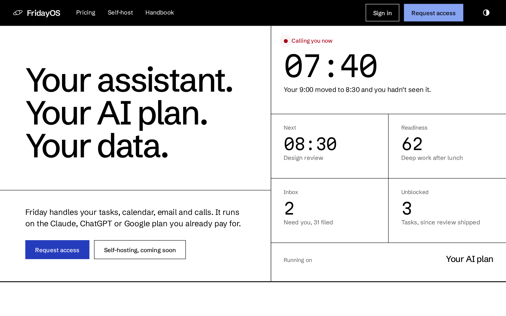

# FridayOS

Friday is a personal AI assistant. FridayOS runs it for you: each account gets its own private server with Friday, its memory, your calendars and the apps you connect.

Sign up at [systems.cyberneel.com](https://systems.cyberneel.com).

## This repository

Friday's source is private for now. This repository holds the part of Friday that talks to [publik](https://publikhq.com), and a small launcher:

- `src/publik.rs` is the module Friday runs. It gets your server its own publik key (`POST /api/v1/installs`), waits for you to sign in (`GET /api/v1/wallet`), and counts usage (`POST /api/v1/telemetry`).
- `src/main.rs` is the launcher. `cargo run --release` signs you in with publik, then opens a page on this computer (http://127.0.0.1:7340) that links to your account. Friday itself runs on your server, not here.
- `publik-app-token.txt` is Friday's publik app token. It is public by design: it can only create capped keys for this app.

## Sign in with publik

On your account page, under Connect your AI, choose publik and click Sign in with publik. Your server gets its own key, and signing in links that key to your publik wallet. Friday then runs on publik's pay-as-you-go models, paid from that wallet. Disconnect removes the key from your server.

## Support

support@cyberneel.com
